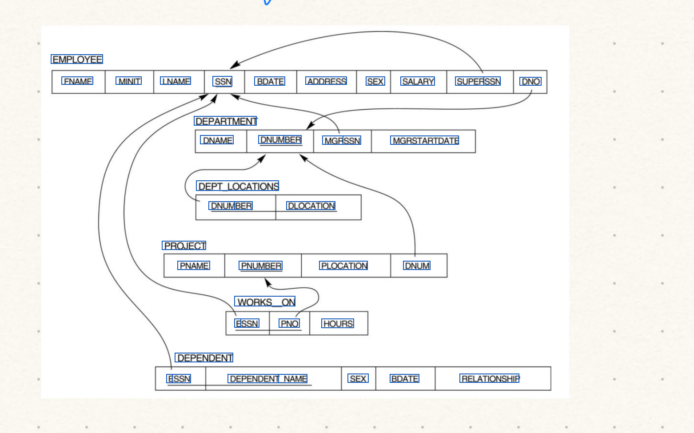
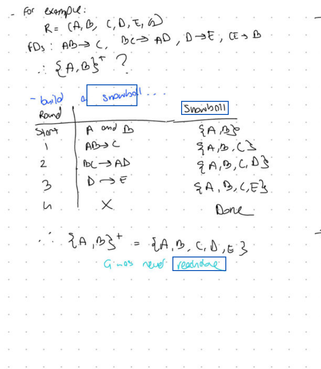
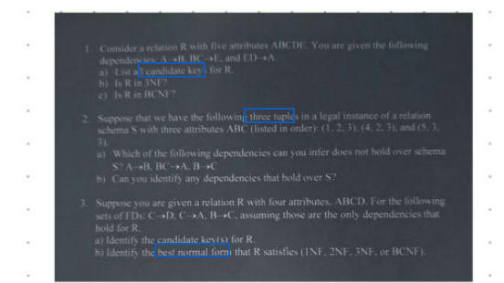
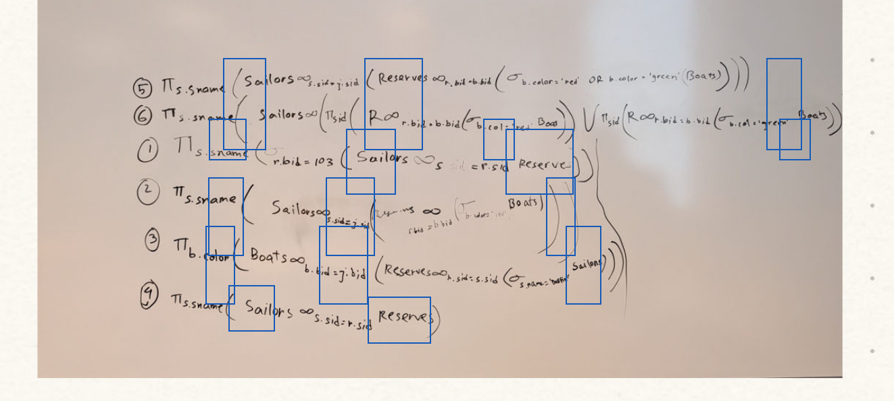

# Dense document and notebook recovery — 2026-10-24

Detector-guided regional recognition recovers dense-page lines, printed notebook
schema fields and text inside an embedded whiteboard photograph. Both final
full-document runs recognize **27/27 pages** and pass **46/46 content checks**,
with no page errors or timeouts. The focused tests additionally check positions
in actual searchable PDFs. Transcription of ambiguous handwritten mathematics
remains imperfect; these results establish improvements on the supplied corpus,
not complete recognition of arbitrary documents.

The final full runs use the runtime sources recorded at `cbcf27dc0ca2437f0beb12b56eef76d0c8f323a5`. Requests
went through the production OpenAI-compatible adapter to standalone local
llama.cpp, serving LightOnOCR-3-4B Q8_0 on an RTX 3080 with 10 GiB VRAM. Surya
provides geometry on CPU. The server endpoint and model remain configurable;
the defaults remain `http://localhost:1234/v1` and `lightonai/LightOnOCR-3-4B`.

## Recognition and placement

The shared native recovery layer separates source geometry from recognition.
It groups detected lines at whitespace gutters and rereads contextual regions
on dense pages or inside excluded visual regions. The selected vision model
supplies every word. Generated figure descriptions remain excluded. A failed
full-page read switches to detected regions immediately; local failures get a
sampled retry and bounded subdivision within the existing 240-second page
deadline. Truncated completions are rejected rather than accepted as OCR.

The initial page image retains the established resolution. Only pages needing
recovery load a 400 dpi source canvas, capped at 4096 pixels, and inference
images remain capped at 2048 pixels. This avoids the recognition regressions
observed when every initial page was rendered at 400 dpi. Unselected pages are
not loaded for OCR, completed source canvases are released, and rectified
photographs retain their coordinate frame. The provider and source-loader
interfaces remain injectable.

Dense pages also reuse the detector on four overlapping source views. This
finds tiny printed lines that disappear in a full-page detector thumbnail,
while keeping existing detections unchanged. Crop padding stops at the gutter
before adjacent detected text, avoiding incomplete neighboring questions that
caused an invented table in an earlier probe.

Regional views with sparse, faint colored strokes on a light background use
minimum-channel ink contrast. This corrects the cyan `reachable` line that
the original colors produced as `readable` with the same prompt and model.
Monochrome views, colored backgrounds and filled highlights retain their
original pixels. The source document backgrounds remain unchanged.

Local blocks anchor to unambiguous detected lines. Equal-count, nearby rows
in a single column can also use their vertical order when model coordinates
drift upward; distant rows and competing columns retain spatial matching.
Paragraphs that join regular print rows distribute their unchanged words
across the source lines. Inline math stays intact, while display math, tables,
code and irregular layouts retain their existing treatment. Placement within
a reconstructed paragraph is approximate.

Table cells keep separate columns, nearby duplicate overview passages are
removed, and an empty regional
reread preserves existing text. Supported LaTeX becomes searchable Unicode;
PDF font fallback retains Greek letters and relational operators. Unknown
macros, code and currency remain literal. This produces useful extraction,
not a full mathematical typesetting engine.

## Comparable before and after scores

The old predictions are the unchanged captures from the
[preceding LightOn validation](lighton-layout-2026-10-24.md). Both sets are
rescored against identical current references with the same HTML/LaTeX decoder.
This avoids presenting formatting improvements or reference changes as new
recognition. Geometry matching is page-aware and uses the same IoU thresholds.

| Document | Mode | Visible word F1 | Box H-mean | Character-position recall |
|---|---|---:|---:|---:|
| dense | grounded | 0.7796 → 0.7919 | 0.2309 → 0.7270 | 0.3964 → 0.8606 |
| notes | grounded | 0.7458 → 0.7417 | 0.4627 → 0.6339 | 0.8179 → 0.9247 |
| dense | hybrid | 0.8052 → 0.7851 | 0.1861 → 0.7082 | 0.3601 → 0.8275 |
| notes | hybrid | 0.7286 → 0.7563 | 0.4942 → 0.6363 | 0.7965 → 0.9349 |

Geometry improves in all four comparisons. Transcription is mixed: visible
word F1 increases for grounded dense pages and hybrid notebook pages, while
hybrid dense pages fall by 0.0201 and grounded notebook pages by 0.0041.
The targeted recognition failures are fixed, but regional rereads do not
improve every ambiguous handwritten word.

Character-position recall measures how much reference text is covered by
predicted boxes; it is **not** the fraction of correctly recognized characters.
Box H-mean penalizes different segmentation. Word F1 measures transcription
without relying on placement, but does not assess reading order or formula
semantics. The source-position tests complement these aggregate scores.

The following primary scores retain the evaluator's established raw-text
normalization, including native markup:

| Document | Mode | Blocks | Raw word F1 | Box H-mean | Character-position recall | Checks |
|---|---|---:|---:|---:|---:|---:|
| digital.pdf | grounded | 19 | 0.9925 | 0.7429 | 0.9048 | 13/13 |
| hybrid.pdf | grounded | 14 | 1.0000 | 0.3462 | 0.9572 | 13/13 |
| handwritten.pdf | grounded | 7 | 0.9324 | 0.5714 | 0.9935 | 10/10 |
| dense.pdf | grounded | 326 | 0.6630 | 0.7270 | 0.8608 | 5/5 |
| notes.pdf | grounded | 448 | 0.5932 | 0.6339 | 0.9252 | 5/5 |
| digital.pdf | hybrid | 19 | 0.9925 | 0.6857 | 0.9052 | 13/13 |
| hybrid.pdf | hybrid | 14 | 1.0000 | 0.3077 | 0.9542 | 13/13 |
| handwritten.pdf | hybrid | 14 | 0.9324 | 0.9286 | 0.9935 | 10/10 |
| dense.pdf | hybrid | 325 | 0.6640 | 0.7082 | 0.8278 | 5/5 |
| notes.pdf | hybrid | 454 | 0.5990 | 0.6363 | 0.9354 | 5/5 |

The dense reference now includes 16 previously omitted lines in the printed
exercise panel on page 3. They were transcribed from source pixels at 600 dpi,
with the crop and coordinates retained in
[the addition audit](reference-additions-2026-10-24.json). All 365 prior dense
annotations and the notebook reference remain unchanged. The historical
olmOCR dense control was rescored from the same frozen predictions; its old
version is archived. No content-matching or metric tolerance was relaxed, and final LightOn
predictions were not promoted to a baseline. The full runs use a separate empty
baseline directory: content checks passed, while cross-model metric regression
gates were not run.

## Actual end-to-end validation

- **723 offline tests passed**, with 28 opt-in live cases deselected.
  These cover recovery, cancellation, injected clients, page selection, real
  SDK transport, source loading, table placement and Unicode PDF extraction.
- All **28 live cases pass on the final implementation**: 14 in each mode.
  The matrix covers three seeds for four first-page documents plus the later-page
  dense/notebook cases in both modes. Earlier failures remain in their logs,
  including a hybrid server-stall timeout that passed on its own rerun before
  the complete final matrices.
- Later-page tests inspect dense pages 2–3 and notebook pages 6, 13, 17 and 21.
  They require all 30 unique printed schema labels, selected field positions,
  exactly two correctly placed `SEX` labels, at least four `Sailors` occurrences inside the embedded photograph, and clean
  `Project 1-3` extraction from the last page. Dense page 3 must retain key
  phrases from all three printed exercises at their source positions without the invented
  `Value` table seen in the preliminary crop probe.
- Full-corpus inference processes one digital page, one form, one handwriting
  page, three dense pages and 21 notebook pages in each mode.
- Both full-corpus outputs are also written as searchable PDFs and checked
  for the dense and notebook positions, duplicate labels and last-page text.
- All three real CLI paths pass the **130-page `--pages 2,4`** check. Requests
  omit the model argument, use the LightOn default, and render only selected
  source indices 1 and 3 for OCR.
- Both web API uploads return **HTTP 200** searchable PDFs with text only on
  selected source page 2, using an empty model form field.
- Actual AVIF word F1 is **1.0000** in hybrid
  and **1.0000** in grounded mode.
- Wheel and source-distribution builds pass, and packaged runtime Python and
  web assets match the working sources.

## Retained failures and limits

The first full candidate used a 400 dpi initial image and failed `Halting` and
`FK can have null value` despite recognizing all pages. Its output remains in
`full-grounded-v6-*`; the final lazy-source implementation restores the prior
initial image. Earlier overaggressive rereads also lost context and duplicated
words, so only explicit visual omissions or failed local reads subdivide.
Plain OCR probes that produced figure descriptions were not adopted.

Visual inspection of the actual PDF search layer found a misplaced duplicate
schema label after the earlier field-presence checks passed. The stronger live
assertion failed in `live-cell-hybrid-v10`. Anchoring isolated source lines and
merging their unique nearby coarse duplicates resolved it; the final four
later-page cases pass the stricter assertions. The interrupted
`before-cell-merge-grounded` partial run remains separate from the complete
final runs.

The blue rectangles are actual PDF search results over the source pixels,
not model-reported confidence values.

A subsequent complete grounded run failed on notebook page 13 when detected
bullets and dots returned empty native responses. Source inspection and the
retained raw responses identify those non-text marks. Completed empty
regional responses now follow the existing empty-JSON contract; empty pages,
malformed nonempty output, reasoning-only output and truncation still fail.
The expanded notebook cases exercise page 13 in both modes. That failed full
run is retained under `empty-region-failure-grounded-*`.

The `before-zoom-*` runs passed the original sparse content checks but lost
parts of the dense printed panel. Rescoring and inspection exposed the loss;
the stronger source-position assertions fail against those saved PDFs.
Zoomed detection found 16 panel lines omitted by full-page detection.
The first zoomed probe recovered the questions but included a clipped fragment
of a neighboring question, producing an invented table. Bounding padding by
the neighboring detections removes that fragment; the final live matrices
exercise the stronger assertions. Raw probes and their failures are retained.

A later full run exposed a second representation of an empty region on
notebook page 6: a valid native coordinate marker with no text after it.
The completed response now follows the same no-text contract as an empty
string or JSON block. Invalid coordinates and empty whole pages still fail.
The failed full run is retained under `empty-tag-failure-*`, with a capture
timestamp audit excluding unchanged files from earlier runs.

A PDF export of the next full run found `Snowball` at the neighboring column,
despite correct recognition. A zoomed detection had merged already-detected
lines into a larger box. Supplementary detection now rejects overlap relative
to either rectangle, preserving the original line geometry. The interrupted
run and the failed PDF-position check remain under `overlap-failure-*`.

Visual inspection of the next seeded hybrid PDF found the correctly recognized
`reachable` line placed on the formula above it. The earlier broad position
check had accepted that displacement. The stricter source-row assertion fails
against the saved PDF. Constrained row ordering now places the text on its
detected cyan source line, and both final live matrices use that stricter check.
The completed grounded candidate and intentionally interrupted hybrid run
remain separate under `before-row-anchors-*`.

The same visual review exposed joined paragraphs squeezed into one source row
in the printed exercise panel. The stronger checks now require `candidate keys`,
`three tuples` and `best normal form` on their actual source rows. They fail
against the saved pre-expansion PDF; the raw positions and before image remain
under `paragraph-position-*`.

The older CLI trace also rejected the valid lazy source render by assuming
exactly one render and one request per selected page. The corrected harness
identifies full-page requests by their pixels, counts regional requests
separately, and still forbids rasterizing any unselected page. Its earlier
false failure is retained under `old-harness-*`.

One hybrid live request stalled in the local model server at generated token
386 for more than three minutes. The application cancelled it at 240 seconds.
Its failed test and server log are retained, and the affected case was rerun
without increasing the deadline. This observed serving stall is separate from
the earlier repeated full-page recovery that exhausted application deadlines.

Dense handwriting and the photograph still contain imperfect readings of
names and mathematical symbols. Sparse content checks do not cover every
word, the handwritten references include ambiguous and overlapping regions,
and the model can still return valid but incorrect text. The earlier
PP-DocLayoutV3 experiment remains documented in the preceding report; this
change uses the existing Surya line detections rather than adding an unproven
layout dependency.

The photograph's mathematical text is searchable at the region level, but
individual word boxes inside formulas remain approximate. The following
actual search rectangles expose that remaining limitation:

[Capture manifest and raw evidence](captures/dense-notebook-2026-10-24/manifest.json)
record runtime source hashes, model hashes, actual completions, test outcomes,
failed candidates, source verification and reproducible harnesses. Text hashes
normalize CRLF to LF. Summed request durations in captures are observations on
this local machine, not a controlled throughput benchmark.

Key results, images and harnesses are directly readable. Full responses and
failed-run data are stored in
[raw-evidence.zip](captures/dense-notebook-2026-10-24/raw-evidence.zip);
the manifest identifies each member and records its checksum. The expanded
data passed the publication audit before packing, and the archived verifier
checks both the ZIP and every contained file.
